<p align="center">
  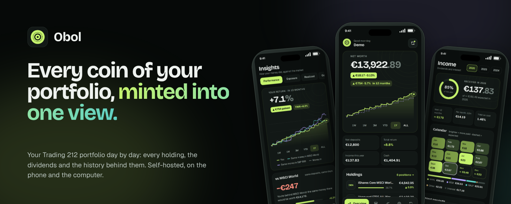
</p>

<p align="center">
  A <b>self-hosted</b> portfolio tracker for <b>Trading 212</b>: what everything is worth today and every day before,<br>
  each holding against what you paid, the dividends that came in and the ones on their way — on the phone and on the
  computer, on your own server.
</p>

<p align="center">
  
  
  
  
  
  
</p>

<p align="center">
  <a href="#features">Features</a> ·
  <a href="#screenshots">Screenshots</a> ·
  <a href="#quick-start-docker-on-the-nas">Quick start</a> ·
  <a href="#connecting-trading-212">Trading 212</a> ·
  <a href="#how-the-numbers-work">The numbers</a> ·
  <a href="#development">Development</a>
</p>

<p align="center">
  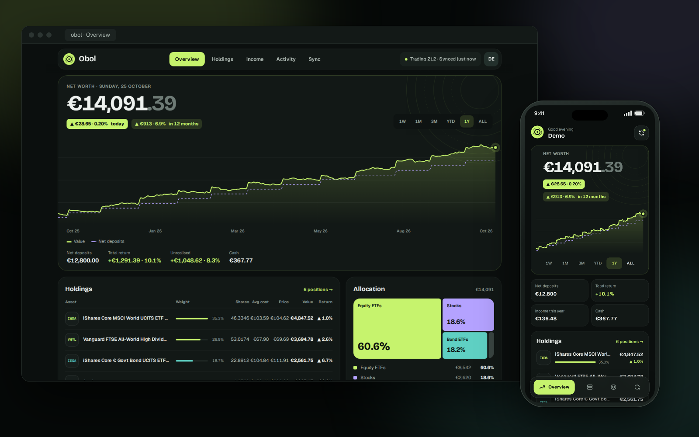
</p>

> Obol only reads your account: it can't place orders or move money, and nothing it shows is financial advice.
> (An obol was the small silver coin of ancient Greece.)

---

## Features

**Overview**

- **Net worth** on a minted card: positions plus cash, today's change and the gain over the range you pick
  (1W · 1M · 3M · YTD · 1Y · All). The gain leaves out the money you put in meanwhile, so a deposit is never a "gain".
- **Value of every day**, drawn smooth with a cursor (finger or mouse), and the money put in as a dashed line.
- **Allocation** as a treemap: equity ETFs, bond ETFs, stocks, cash.
- **Holdings grouped by your Trading 212 pies**, as the app shows them: each pie with its value, what you put in and
  its gain in € and %, open it to see its holdings; what you hold outside the pies sits next to them. A switch flips to
  one line per stock.
- **Movers of the day**, the **next dividends** and how far this year's income has come.

**Two looks** (Settings › Look, per device): **Mint**, the coin from the landing with glows, engraved rings and soft
cards, and **Ledger**, calm and editorial with a side menu, hairlines instead of cards and the numbers in mono columns.

**Holdings**

- Every position with its **logo** (logo.dev, cached on the server; a ticker badge without a key), weight, value,
  return since bought (in € and %, green or red) and today's move. Filter (ETFs · Stocks), find and sort by value, return or name.
- **A position**: the price chart with every buy and sell marked, the average price you paid as a guide line, the
  dividends it paid, what you put in and what you took out.

**Insights**

- **Performance against the market**: your **money-weighted** return (XIRR: how your money did, deposits' timing
  included) and **time-weighted** return (TWR: how funds and indexes report), and what **the same deposits, on the same
  days**, would be worth in **MSCI World** or the **S&P 500** — "am I beating the index?" in one chart. Plus a heatmap
  of every month's return.
- **Exposure**: how much is in each **currency** and what the exchange rate added or took since you bought (and what a
  5 % stronger euro would do), **sectors**, **countries**, and **concentration** (biggest position, top 5, effective
  number of positions).
- **Realized**: what every sale made, at average cost as Trading 212 counts it, by year and by position, with the hit
  rate.
- **Goals**: where the portfolio could be in N years adding Y a month, in careful, steady and strong scenarios, and when
  the dividends would reach the income you'd like a month. Sliders, worked out live.
- **AI coach** (optional): an AI reads your positions, sectors, currencies, income and returns and writes a short
  review — what's working, what to keep an eye on (concentration, repeated bets, dividends at risk, currency) and three
  things to look at. Bring a **Claude** or **Gemini** key, or run a **local model with Ollama** so nothing leaves your
  network. It never tells you to buy or sell anything.

**Income**

- A **calendar** of what each month paid and what the rest of the year should bring, **yield on cost**, the next 12
  months and where the income comes from. Interest on cash counts too.
- **By position**: what each one paid in the last 12 months, its yield and yield on cost, whether the last payment per
  share was **raised or cut**, and the **tax withheld abroad**.

**Activity**

- Every buy, sell, dividend, deposit, withdrawal, interest and fee, newest first, filtered by kind.

**Sync**

- **Trading 212 API** with a read-only key: positions and cash every 30 minutes, every order, dividend and transfer
  since the account opened (incrementally after the first time). The key and secret are kept **encrypted** (AES-GCM).
- **CSV import** of Trading 212's history export, for history the API doesn't reach or without a key at all.
  Importing the same file twice — or a file covering what the API already synced — never doubles anything.
- **Price history** from Yahoo Finance (daily closes, exchange rates) so the charts are exact; optional.
- The sync log of the last 30 runs, the switches for what to read, and **Start over**.

**Built to self-host**

- One `docker-compose.yml`: **SQL Server 2022 Express**, a one-shot **database deploy** (tables and stored procedures
  from a dacpac, applied again on every update), the **WebApi** and the **Website**.
- **Accounts for the house**: everyone sees only their own portfolio; the first account (protected by a setup key) is
  the admin. Sign-ups can be closed.
- **Phone and computer**: the same pages, a dock on the phone and a top bar on the computer; adds to the Home Screen
  like an app. One dark look: lime on ink-green, Bricolage Grotesque, Geist and Geist Mono.
- **Demo mode**: a year of a believable sample portfolio in memory, no SQL Server or Trading 212 needed — to try it, or
  to take screenshots.
- **Read-only by design**: Obol never asks for the trading permissions, and the fonts and icons ship with the app.

## Screenshots

### Your portfolio
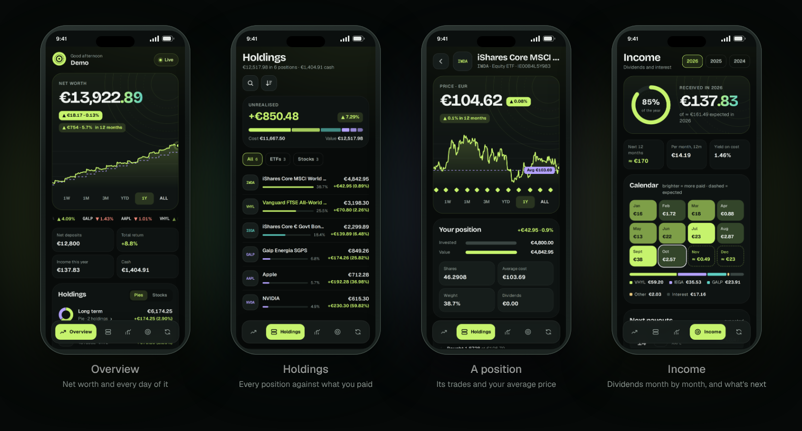

### Insights
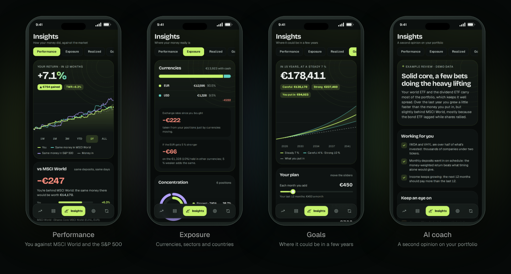

### Realized, activity and sync
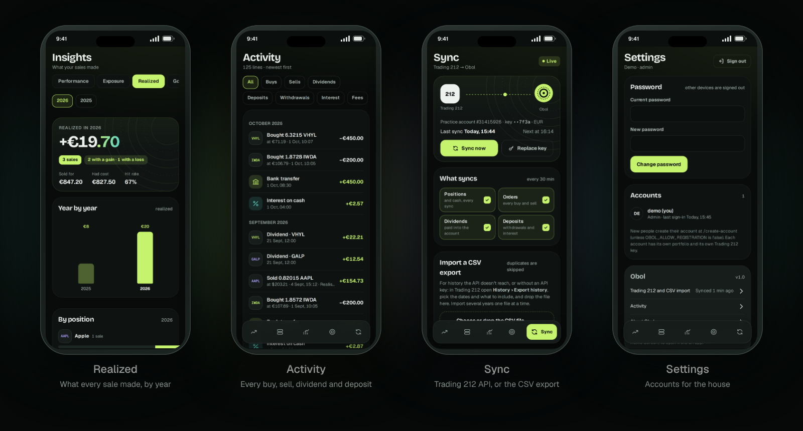

### On the computer
<table>
<tr>
<td width="50%"><b>Performance</b><br>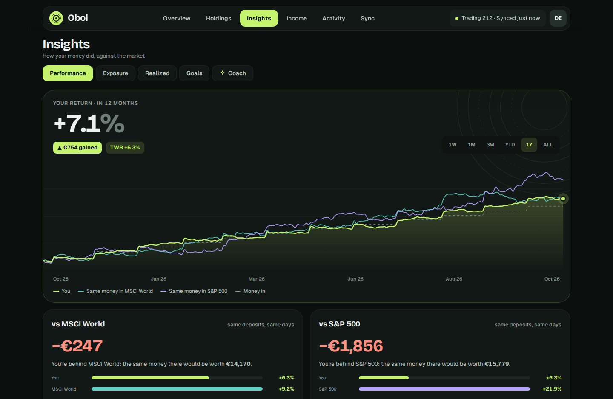</td>
<td width="50%"><b>Exposure</b><br>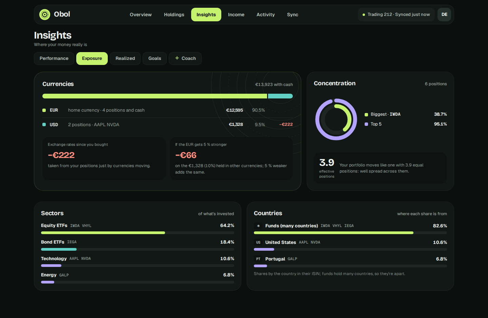</td>
</tr>
<tr>
<td width="50%"><b>Realized</b><br>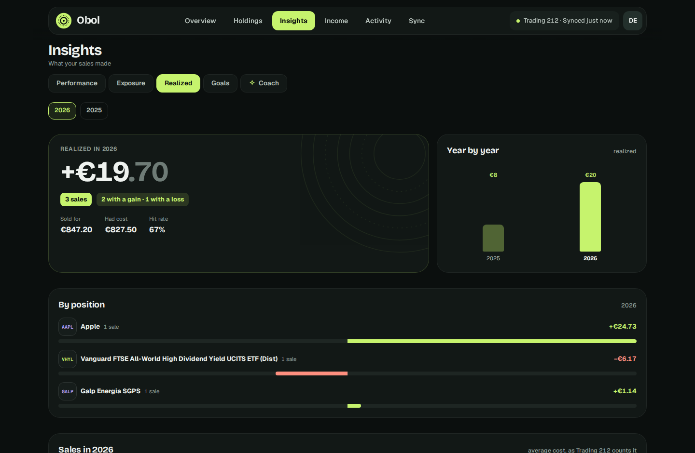</td>
<td width="50%"><b>Goals</b><br>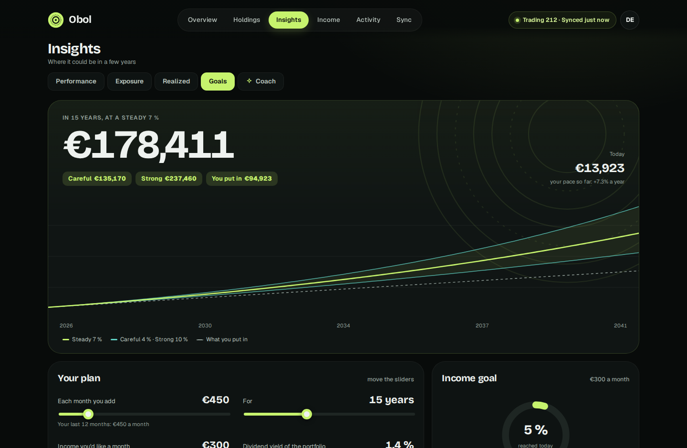</td>
</tr>
<tr>
<td width="50%"><b>AI coach</b><br>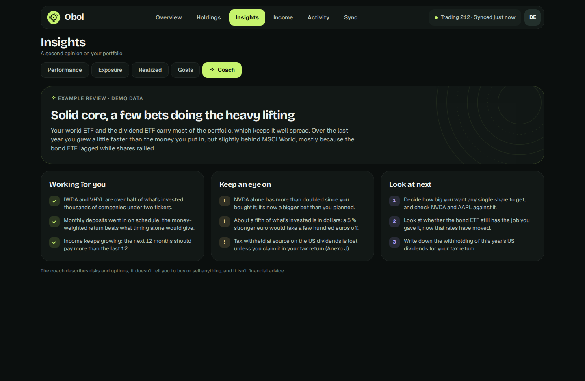</td>
<td width="50%"><b>Holdings</b><br>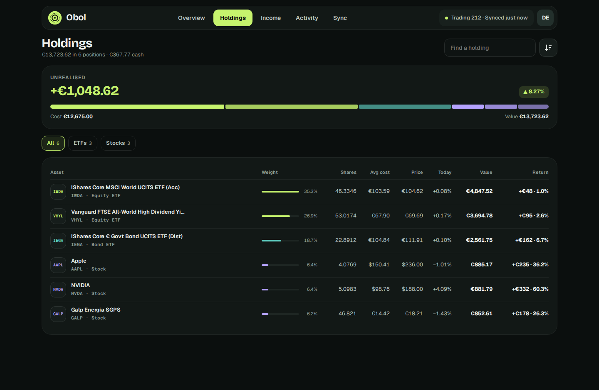</td>
</tr>
<tr>
<td width="50%"><b>A position</b><br>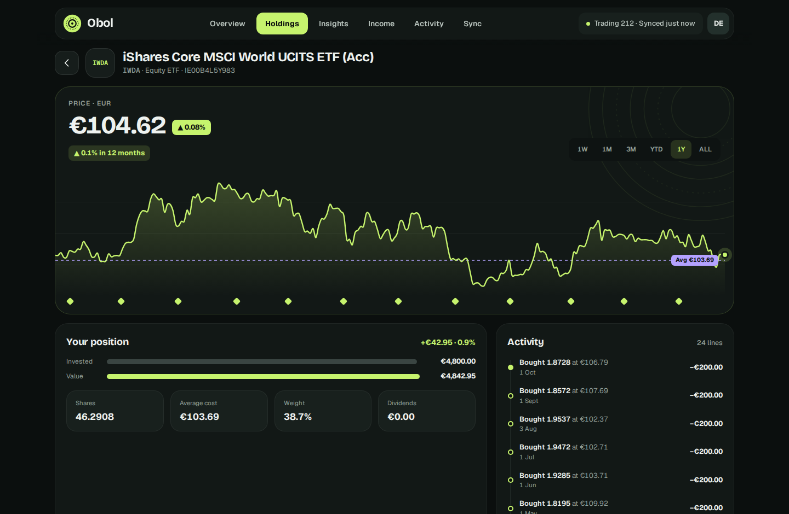</td>
<td width="50%"><b>Income</b><br>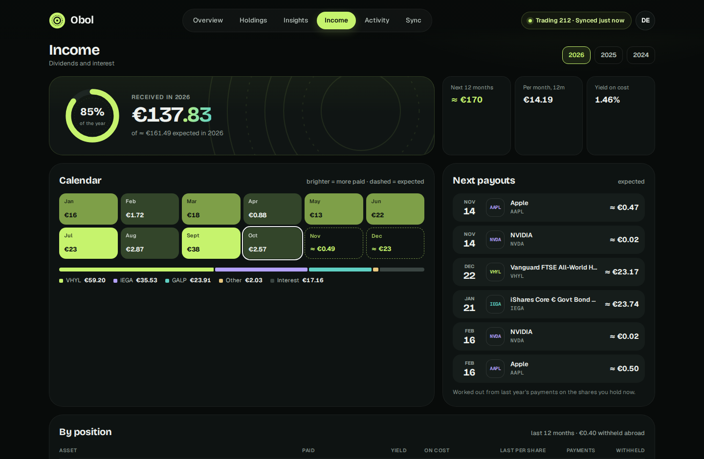</td>
</tr>
<tr>
<td width="50%"><b>Activity</b><br>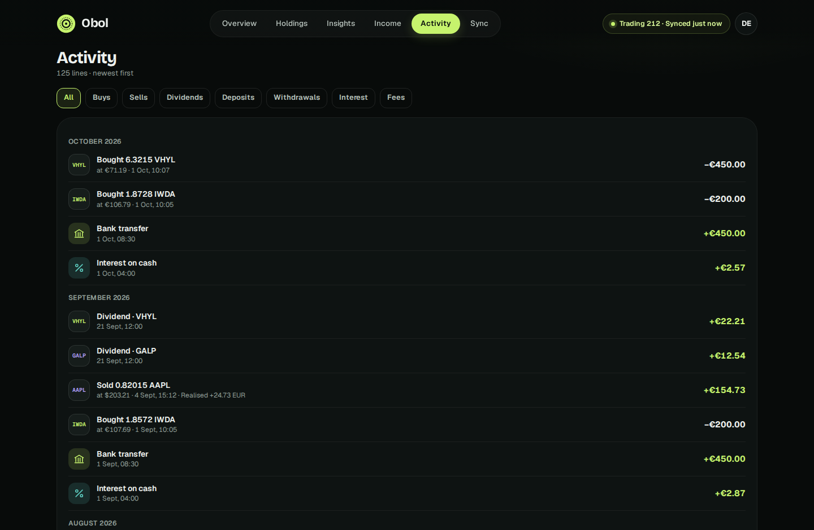</td>
<td width="50%"><b>Sync</b><br>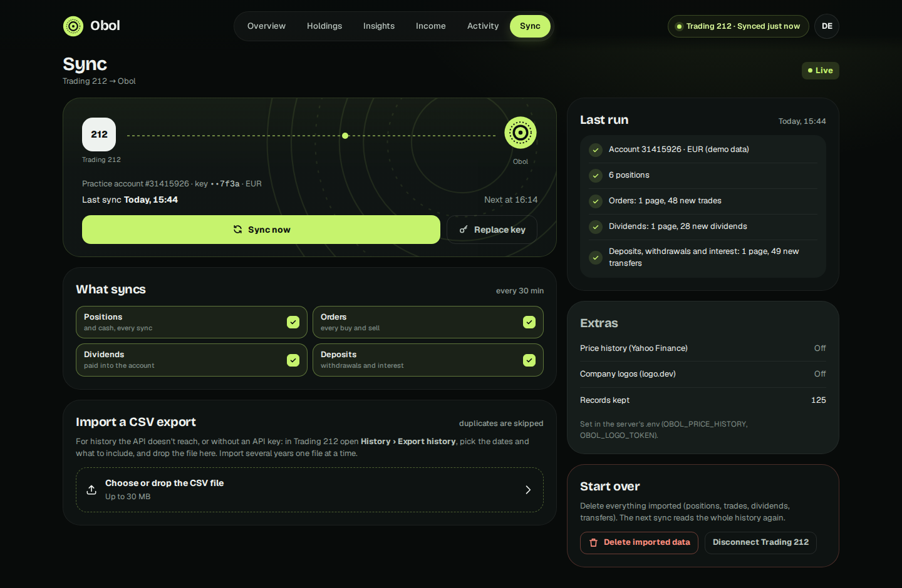</td>
</tr>
</table>

### Welcome
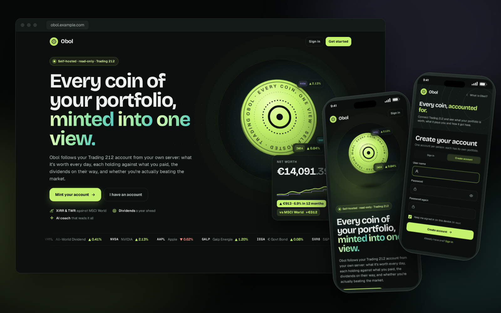

## Quick start (Docker on the NAS)

```bash
git clone https://github.com/rodrigocoelho2/Obol.git && cd Obol
cp .env.example .env          # then set SQL_SA_PASSWORD, OBOL_API_KEY, OBOL_ENCRYPTION_KEY and OBOL_SETUP_KEY
docker network create nas-net # once, if it doesn't exist yet
docker compose up -d --build
```

Four containers start: **obol-sql** (SQL Server 2022 Express), **obol-db-deploy** (publishes the database project —
creates the `Obol` database the first time, applies schema changes on later deploys — and exits), **obol-webapi**
(the engine; no port, only the website reaches it) and **obol-website** (the app). Open `http://<nas-ip>:5095`, create
the first account with the setup key (it becomes the admin) and you land on **Sync**.

> The stack is called `obol` whatever the folder is called, so its volumes are always `obol_sql` and `obol_keys`.

| Setting (`.env`) | Default | What it does |
| --- | --- | --- |
| `SQL_SA_PASSWORD` | — | SQL Server `sa` password (8+ characters, three of upper, lower, digits, symbols). |
| `OBOL_API_KEY` | — | Internal key between the website and the WebApi (any long random string). |
| `OBOL_ENCRYPTION_KEY` | — | Encrypts the Trading 212 key and secret in the database (16+ characters). Keep it: if it changes, connect Trading 212 again. |
| `OBOL_SETUP_KEY` | — | Asked for only when creating the first account, so nobody else on the network can claim it. |
| `OBOL_LOGO_TOKEN` | — (badges) | A free publishable key from [logo.dev](https://logo.dev) for company and fund logos. |
| `OBOL_PRICE_HISTORY` | `true` | Daily closes from Yahoo Finance for the charts. `false`: only the prices Trading 212 and your trades give. |
| `OBOL_CURRENCY` | `EUR` | The account currency for CSV-only accounts (once connected, Trading 212's is used). |
| `OBOL_SYNC_MINUTES` | `30` | Minutes between automatic syncs (`0` = only when you tap Sync now). |
| `OBOL_ALLOW_REGISTRATION` | `true` | `false` once everyone has an account. |
| `TIME_ZONE` | `Europe/Lisbon` | Days start at midnight here. |
| `OBOL_PORT` | `5095` | Host port of the website. |
| `SQL_PORT` | `1436` | Host port for SSMS / Azure Data Studio (`<nas-ip>,1436`, user `sa`). |
| `SQL_MEMORY_LIMIT_MB` · `SQL_CPUS` · `OBOL_CPUS` | `1024` · `2` · `1` | Keep the stack small on the NAS. |
| `OBOL_WEBAPI_MEMORY` · `OBOL_WEBSITE_MEMORY` | `512m` · `384m` | Memory caps of the WebApi and the website. |
| `OBOL_AI_PROVIDER` | — (off) | `anthropic` (Claude), `gemini` (Google AI Studio key) or `openai` (OpenAI, **Ollama**, LM Studio — anything OpenAI-compatible). Empty: the coach explains how to turn it on. |
| `OBOL_AI_API_KEY` | — | The provider's API key (not needed for a local Ollama). |
| `OBOL_AI_MODEL` | `claude-haiku-5-5` · `gemini-3.8-flash` · `gpt-4o-mini` | The model, e.g. `claude-sonnet-5-5` or `llama3.1:8b`. |
| `OBOL_AI_BASE_URL` | OpenAI | For `openai`: e.g. `http://192.168.1.10:11434/v1` for Ollama on the NAS. |
| `OBOL_AI_LANGUAGE` | `English` | The language the coach writes in, e.g. `Portuguese (Portugal)`. |
| `OBOL_DEMO_MODE` | `false` | `true` runs on a sample portfolio in memory (sign in as `demo` / `obol-demo`; every new account gets it too). |

**Nginx Proxy Manager:** the website joins `nas-net`, so a proxy host can forward to `http://obol-website:8080` (with
your wildcard certificate). Installing Obol on the phone's Home Screen needs HTTPS.

**Updating:** `git pull && docker compose up -d --build`. The database deploy runs again and only applies what changed.

**Backups:** the data lives in the `obol_sql` volume; back up the database (`BACKUP DATABASE Obol TO DISK = …` from
SSMS) or the volume. Everything can also be read again from Trading 212 (Sync › Start over).

## Connecting Trading 212

1. In the Trading 212 app or website open **Settings › API (Beta)** and accept the terms.
2. **Generate API key** for the account you'll connect, name it Obol and tick the read permissions: **Account data**,
   **History - Dividends**, **History - Orders**, **History - Transactions**, **Metadata**, **Pies - Read** and
   **Portfolio**. Leave the order and pie-writing permissions off — Obol never trades. A key without one of them still
   syncs the rest, and Sync says which permission to turn on (without **Pies - Read** the Overview lists one line per
   stock).
3. Copy the **key** and the **secret** (the secret is shown only once) into **Sync › Connect Trading 212**, pick
   *Real money* or *Practice*.

Obol checks the key with Trading 212, then reads the whole history the first time. Trading 212 allows about 20 history
pages a minute, so a long history can take a few minutes; you can leave the page. After that, each sync only reads
what's new. The API covers **Invest** and **Stocks ISA** accounts (not CFD).

**CSV export:** in Trading 212 open **History › Export history**, pick the dates (up to a year per file) and what to
include, and drop the file on **Sync › Import a CSV export**. Older and newer export layouts are both read (the columns
are found by their names). Stock splits and other corporate actions in the file are counted, not applied.

## How the numbers work

- **Positions** come from Trading 212 after a sync (shares, average price, value). A CSV-only account works them out
  from the trades, at average cost: a sale takes its share of the cost.
- **Value of every day** starts from today's shares and cash and walks back through every trade, dividend and
  transfer, valuing each day at that day's close and exchange rate. Days without a close carry the last one forward;
  trades fill in prices and exchange rates when Yahoo has none. Pence (GBX) and pounds are told apart.
- **Gain over a range** = value at the end − value at the start − money put in meanwhile, as a share of what was there
  (plus what was added). **Total return** = net worth − net deposits.
- **Money-weighted return (XIRR)** is the one yearly rate that turns every deposit, on its day, into today's value.
  **Time-weighted (TWR)** chains each day's move with that day's deposits taken out. **The same money in an index**
  buys units of the index ETF (EUNL, SXR8, in euros) with the first day's value and every later deposit at that day's
  close. When the deposits aren't synced, the trades are the flows and only what's invested is measured.
- **Exchange-rate effect** is Trading 212's figure per position, or the shares at today's price times the change of the
  rate since the average buy.
- **Expected income** repeats every payment of the last 12 months on the shares you hold today (per share), a year
  later. It's an estimate: companies change their dividends.

## Development

### Solution layout

```
Obol.slnx
├── Obol.Database/            SQL Server project (SDK-style .sqlproj → dacpac)
│   ├── Tables/               User, BrokerConnection, SyncRun, Instrument, Holding, Trade, Dividend, CashMovement,
│   │                         AccountSnapshot, PriceDay, FxDay, InstrumentLogo
│   ├── StoredProcedures/     Users, Connections, Instruments, Portfolio, Prices, Logos — the only way the WebApi touches data
│   └── Scripts/              post-deployment script and deploy.sh (used by the db-deploy container)
├── Obol.Library/             enums, ServiceApiResponse, validation types, header names (no ASP.NET)
├── Obol.WebApi/              ASP.NET Core API (x-api-key): the sync, prices, logos and the portfolio maths
│   ├── Extensions/           API-key authentication, data (Dapper over stored procedures, memory store), time, secrets
│   └── Features/             Users, Connections, Trading212, Csv, Instruments, Portfolio, Insights, Prices, Logos, Syncs, Demo, Health
│       └── <Feature>/        Controllers, Models (Entities, DTOs), Repositories (SQL + memory), Services, Http samples
├── Obol.Sdk/                 typed client of the WebApi and copies of its DTOs (the Website never references the WebApi)
├── Obol.Website/             ASP.NET Core MVC: the landing page, sign-in and the app
│   ├── Controllers/          thin: fill the shell, call the model, return the view
│   ├── Model/                page models that call the Sdk
│   ├── Helpers/              SVG charts (line, sparkline, ring), icons, formatting, the clock
│   ├── Views/                Razor views, one folder per screen
│   └── wwwroot/              css/app.css (the app) and css/public.css (landing, sign-in), js/app.js, fonts, icons
└── Obol.UnitTest/            xUnit: the portfolio maths, the CSV parser and API mapping, the services on the demo data, the Sdk contract
```

WebApi controllers only map HTTP to services; services hold the rules and answer with `ServiceApiResponse<T>`;
repositories only call stored procedures (lists go in as JSON through `OPENJSON`). The Website's controllers stay thin
and its models call the WebApi through `Obol.Sdk`. Everything is stored in UTC; days are local to `TIME_ZONE`.

### Running it on the PC

- Visual Studio (or `dotnet`) with the .NET 10 SDK. Start **Obol.WebApi** (`http://localhost:5096`, Swagger at
  `/swagger`) and **Obol.Website** (`http://localhost:5095`) together (multiple startup projects).
- No SQL Server? Copy `Obol.WebApi/appsettings.Development.json.example` to `appsettings.Development.json` (it has
  `"DemoMode": true`) and sign in as `demo` / `obol-demo`.
- With SQL Server: `docker compose up -d sqlserver db-deploy`, set `"DemoMode": false` and the connection string
  (`Server=localhost,1436;Database=Obol;…`).
- Both projects need the same API key (`Obol:ApiKey` in the WebApi, `ObolApi:ApiKey` in the Website):
  `Obol.Website/appsettings.Development.json.example` has the matching one.
- `Obol.WebApi/Features/*/Http/*.http` have a request for every endpoint, including a CSV import of
  `.github/scripts/sample-export.csv`.

### Tests

```bash
dotnet test Obol.UnitTest
```

GitHub Actions (`.github/workflows/ci.yml`) builds everything, publishes the dacpac to SQL Server twice (the second
publish must change nothing) and runs the tests; then it starts the Compose stack, smoke-tests it, creates the first
account with the setup key, imports a Trading 212 CSV export twice into SQL Server (the second import must add
nothing) and screenshots every page (also on the demo portfolio). Logs and screenshots are pushed to the
`ci-output-build` and `ci-output-compose` branches.

### API (Obol.WebApi)

JSON, every call with the `x-api-key` header. `userId` is the account's id (32 hex characters).

| | |
| --- | --- |
| `GET user/status`, `GET user/list`, `GET user?identifier=`, `POST user`, `POST user/signin`, `POST user/password`, `DELETE user?identifier=` | accounts |
| `GET connection?userId=`, `POST connection`, `POST connection/options`, `POST connection/sync?userId=`, `DELETE connection?userId=`, `DELETE connection/data?userId=` | Trading 212: the key, what syncs, sync now, the log, start over |
| `POST connection/csv?userId=` | a Trading 212 CSV export (the file as the body) |
| `GET portfolio/overview?userId=&range=` | net worth, the value chart, allocation, movers, income |
| `GET portfolio/holdings?userId=` | every position |
| `GET portfolio/position?userId=&key=&range=` | one instrument: prices, trades, dividends |
| `GET portfolio/activity?userId=&kind=&skip=&take=` | the activity, newest first |
| `GET portfolio/income?userId=&year=` | the income calendar of a year |
| `GET insights/performance?userId=&range=` | money- and time-weighted returns, against MSCI World and the S&P 500, monthly returns |
| `GET insights/exposure?userId=` | currencies (with the exchange rate's effect), sectors, countries, concentration |
| `GET insights/realized?userId=&year=` | what the sales of a year made |
| `GET insights/goals?userId=` | where the portfolio is now, for the projection |
| `GET`/`POST insights/coach?userId=` | the AI coach; POST starts a review in the background, poll GET |
| `GET logo?key=&symbol=` | an instrument's logo (PNG, cached) |
| `GET health` | status (no key needed) |

## Licences

Fonts: Bricolage Grotesque, Geist and Geist Mono, SIL Open Font License (`Obol.Website/wwwroot/fonts`).
Not affiliated with Trading 212. Prices from Yahoo Finance and logos from logo.dev are for personal use under their
terms.
